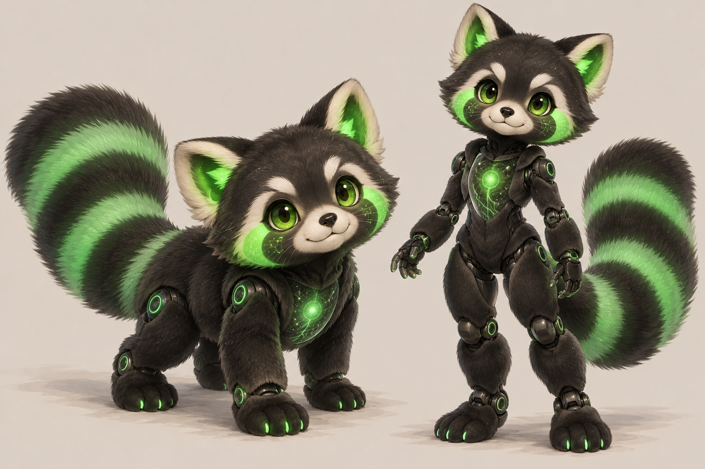
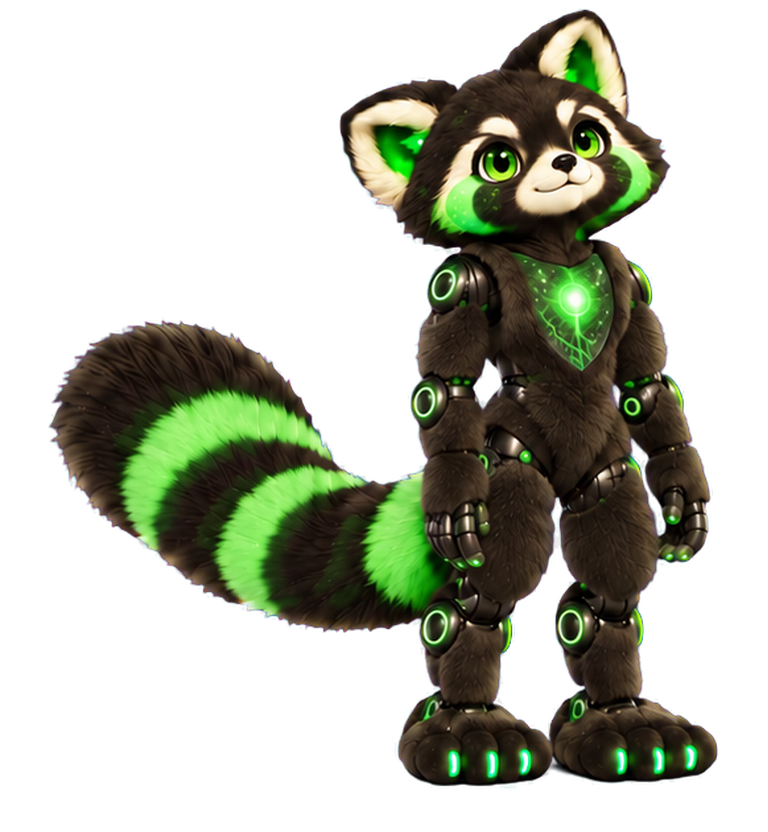

# PaKaChi – erhaltene Vorlagen

## Charakterreferenzen

`Pakachi-Referenz.png` stammt unverändert aus `Pakachi-Etappe-0.zip`.

`Pakachi-Endform-Stilanker.png` ist eine unveränderte Kopie von `refinement-1/Pakachi-Endform-072.png` aus `Pakachi-Qualitaetskorrektur-1.zip`. Sie dokumentiert das wiederhergestellte Fell und die dunklen Gelenke. Sie ist keine Aussage, dass bereits die gesamte Transformation korrigiert wurde.

## Wiederhergestellter Player

`public/legacy/pakachi/` enthält den Originalstand aus `Pakachi-Eigenstaendig-v1.zip` (Version 4, zuletzt geändert am 11.10.2026). Alle 72 PNG-Frames und vorhandenen Quelldateien wurden unverändert übernommen. Ergänzt wurde ausschließlich eine `package.json`, damit die mitgelieferten CommonJS-Tests im neuen TypeScript-Projekt weiterhin laufen.

Die 72 Bilder enthalten Tier-zu-Humanoid-Verwandlung, kein Tablet und keine eigene Arbeitsschleife. Der Player hält die Endformen und nutzt vorläufig die Bilder rückwärts für die Rückverwandlung. Er besitzt bereits optionale MQTT-Steuerung. Seine visuell noch mangelhafte, teilweise metallische Endform ist **nicht** die gewünschte neue Designvorlage; dafür ist die korrigierte Referenz oben maßgeblich.

Weitere Etappen- und Korrekturpakete bleiben im bisherigen Bestand erhalten. Sie wurden nicht automatisch miteinander vermischt. Eine konsistente 3D-Umsetzung beider Formen steht noch aus.

Die technischen Testmodelle Mika und Nori sind separate, prozedural erzeugte glTF-Dateien zur Prüfung von Player, Skelett und Animationswiedergabe. Sie ersetzen PaKaChi nicht.

Seit 0.83.0 sind aus den beiden maßgeblichen Einzelvorlagen erstmals echte [3D-Arbeitsentwürfe](../KI-GENERIERUNG.md#erste-echte-pakachi-entwürfe) rekonstruiert. Sie sind im Model Zoo gesondert auswählbar, ohne Rig oder Bewegungen; die Charakterqualität ist noch nicht abgenommen.
